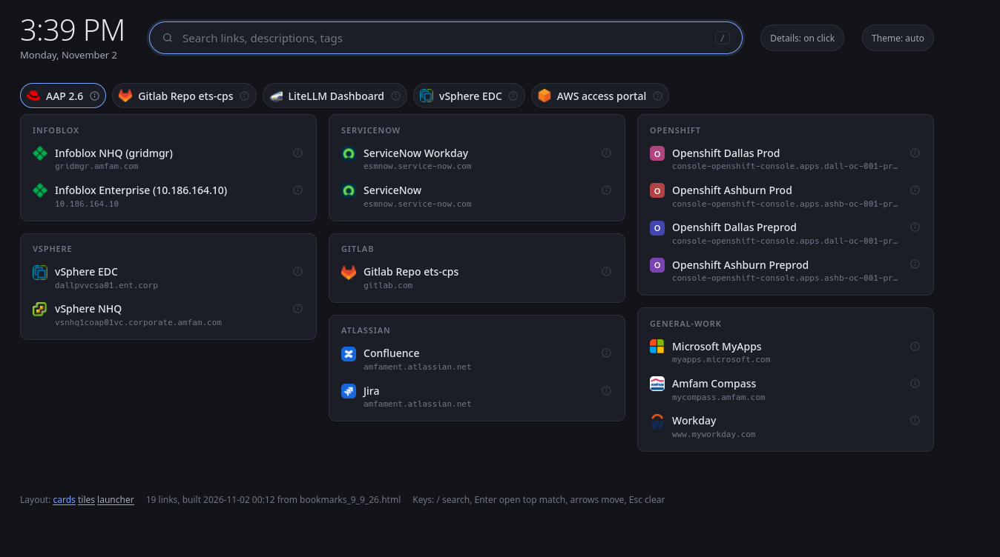

# JYY Web Bookmarks Tab

Turns a Chrome bookmarks export into a static, offline start page (in the style of nightTab) for use as the Chrome homepage on a locked-down work laptop.



AI-Usage: Vibe-coded

## Install

Needs [uv](https://docs.astral.sh/uv/). It installs Python 3.11+ if missing.

```sh
uv sync
```

## Build

```sh
uv run bookmarks-page references/bookmarks_9_9_26.html
```

```
source:  bookmarks_9_9_26.html
links:   19 unique in 7 groups, 5 pinned from 'essentials'
wrote:   dist/cards.html, dist/launcher.html, dist/tiles.html
```

With no argument, `bookmarks-page` uses the newest file in `references/`. Each file in `dist/` is self-contained: favicons, data, CSS, and JS are inlined, and the page makes no network requests.

## Updating bookmarks

1. In Chrome, open `chrome://bookmarks`, then the three-dot menu, then **Export bookmarks**. Save it into `references/`.
2. Run `uv run bookmarks-page`.
3. Reload the page.

Chrome is the source of truth for titles, URLs, and folders. Folders become groups. Nested folders become `parent / child` groups.

## Descriptions, tags, and aliases

Chrome has no description field, so extra info lives in `notes.toml`, matched to bookmarks by exact URL:

```toml
[[link]]
url = "https://gridmgr.amfam.com/ui/"
desc = "DNS and IPAM grid manager for NHQ."
tags = ["dns", "ipam"]
alias = "ib"
```

- `uv run bookmarks-page --init-notes` appends empty entries for links that do not have one yet. It never edits or removes existing entries.
- The build lists notes entries whose URL is no longer in the export. This happens when a bookmark's URL changes in Chrome: update the `url` in `notes.toml` to match.
- A link in two folders shares one entry.

| Field | Effect |
|---|---|
| `desc` | Cards: one line under the link, full text in the details panel. Tiles: on hover. Launcher: in results. Searchable. |
| `tags` | Shown as chips in launcher results. Searchable. |
| `alias` | Extra search words, not displayed. |
| `title` | Overrides the Chrome bookmark title. |

## Settings

The `[settings]` table in `notes.toml`:

| Key | Default | Effect |
|---|---|---|
| `title` | `"Bookmarks"` | Browser tab title. |
| `pinned` | `""` | Folder shown as the pinned row at the top. |
| `hide_pinned_group` | `true` | Do not also show the pinned folder as a normal group. |
| `group_order` | `[]` | Group names to show first, in order. Others follow in export order. |

## Link details (cards)

Each link has an (i) button on its right. Clicking the link opens it as usual; clicking (i) expands a panel with the full description, URL (with a Copy button), folders, tags, aliases, and date added. Pinned links open their panel under the pinned row.

The **Details** button in the header switches between "on click" and "all" (every panel expanded). The choice is remembered in this browser.

## Layouts

`cards` is the main layout. The other two are kept for comparison.

| File | Style |
|---|---|
| `dist/cards.html` | Grid of folder cards, expandable link details. |
| `dist/tiles.html` | Large icon tiles in the style of nightTab, descriptions on hover. |
| `dist/launcher.html` | Search first, collapsible groups, rich results. |

Each page footer links to the other two. Layouts live in `src/bookmarks_page/templates/`, with shared code in `_shared.css` and `_shared.js`.

## Development

```sh
uv run ruff format .
uv run ruff check .
uv run pytest
```

## Keys

| Key | Action |
|---|---|
| `/` or start typing | Focus search |
| `Enter` | Open the top match (`Ctrl+Enter` opens it in a new tab) |
| Arrow keys | Move between links (`Down` from search goes to the top match) |
| `Esc` | Clear search |

`?q=term` in the URL prefills the search.

## Set as the Chrome homepage

1. Open `dist/<layout>.html` in Chrome and copy the `file:///...` URL from the address bar.
2. Settings > **On startup** > **Open a specific page or set of pages** > add the URL.
3. Optional: Settings > **Appearance** > **Show home button**, and set it to the same URL.

Chrome only lets an extension replace the New Tab page, so this page opens on startup and from the home button.
